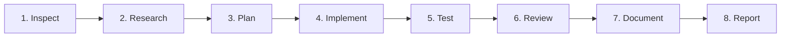

# ARCHON Persistent Engineering Operating Standard

**Status:** Authoritative Workspace Rule  
**Scope:** All ARCHON Development, Planning, Implementation, Testing, and Review  
**Version:** 2.0.0 (October 2026)  

---

## The 8-Stage Engineering Lifecycle

Every non-trivial engineering task in ARCHON must strictly follow this lifecycle:

### 1. Inspect
- Inspect the current directory, repository structure, and Git status.
- Inspect package manifests (`package.json`, `requirements.txt`) and lockfiles.
- Check active environment runtimes (Python, Node.js, CLI versions) and running daemons.
- Read existing architecture documents (`docs/ARCHITECTURE.md`, `PROJECT_SPEC.md`).
- Never assume a tool, file, or dependency exists without checking.

### 2. Research
- Verify primary official documentation before introducing or modifying framework patterns.
- Check version compatibility against installed dependencies (Django 6, Next.js 16, React 19, Neo4j 6).
- Rely on verifiable sources; never invent citations, benchmark statistics, or package versions.
- If network research is restricted or fails, report it honestly and rely on verified local compiler/type definitions.

### 3. Plan
- Formulate the smallest sound, maintainable solution that meets requirements.
- Distinguish essential architectural requirements from optional enhancements.
- Identify integration boundaries, risk points, and affected subsystems.
- Define observable, testable acceptance criteria before writing code.
- Detail the exact files, endpoints, and components to be modified.

### 4. Implement
- **Framework-Native First:** Use official CLI scaffolding tools and generators (`django-admin`, `manage.py`, `npm`) instead of manually recreating boilerplate.
- **Strict Separation of Concerns:** Keep Django views and React pages thin. Place core domain logic in decoupled service modules (`archon/core/`).
- **Strict Typing:** No implicit `any` in TypeScript. Complete type annotations in Python core modules.
- **Small Coherent Changes:** Make surgical, focused edits. Never regenerate an entire application or wipe unrelated files.
- **Zero Fake UI:** Never add placeholder buttons, simulated metrics, or fabricated graph edges.

### 5. Test (Continuous Verification)
- Write automated unit tests for business logic and integration tests for API endpoints.
- Execute the tests using the actual project test runner (`pytest`, `npm test`).
- Test edge cases: invalid repository paths, non-existent symbols, uninitialized Git repos, offline Neo4j.
- Never weaken or delete a test simply to make a suite pass.
- If a check cannot be executed, mark it **NOT VERIFIED**; never fabricate passing results.

### 6. Review
- Inspect the full Git diff or changed files for unwanted side effects.
- Detect dead code, lingering debug logs, or accidental credential leakage.
- Verify that performance is not degraded (e.g. infinite loops, unindexed Cypher queries, giant client bundles).
- Confirm compliance with WCAG 2.2 AA accessibility and zero-code-execution security rules.

### 7. Document
- Update Architecture Decision Records (`docs/engineering-decisions.md`) for any consequential change.
- Update API types (`web/lib/types.ts`) and backend serializers concurrently.
- Document environment variables and setup instructions in `README.md` or dedicated guides.

### 8. Report
- Report actual outcomes with verifiable evidence: command outputs, passing test counts, and exact diffs.
- Explicitly flag any assumptions that still need validation.
- Highlight any strategic decisions that require user approval.

---

## Non-Negotiable Invariants

1. **Zero Target Code Execution:** Analyzed repositories are NEVER imported or executed in the Python runtime. All inspection is static (`ast.parse`, Git CLI).
2. **Privacy & Credential Isolation:** Files matching `.env*`, `*pem`, `*key`, `*token*`, `id_rsa*` are blocked from ingestion and display.
3. **Evidence-First Truth:** Every claim presented to a developer must cite an exact artifact (Commit SHA, File path, Line range, Test ID). Inferred hypotheses must be explicitly demarcated from extracted ground truth.
4. **Offline Resilience:** The application must remain fully functional with in-memory fallbacks when external databases (Neo4j) or network services are unavailable.
5. **No Destructive Operations:** Never run destructive Git commands (`git reset --hard`, `git clean -fd`) or overwrite user files without explicit instruction.
